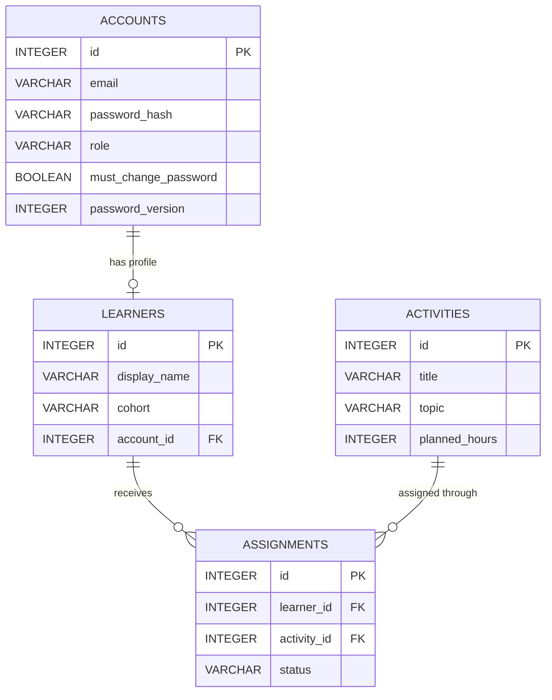

# SkillTrack – Learning Progress Tracker

## 1. Project Overview

SkillTrack is a full-stack Learning Progress Tracker designed to manage learning activities, monitor candidate performance, and track training progress.

The application provides two types of users: Coordinator and Candidate.

The Coordinator can manage learning operations and monitor candidate progress, while Candidates can access their personal training workspace and view assigned learning activities.

The project uses React for the frontend, Node.js and Express.js for the backend, and SQLite for database management.

## 2. Project Objectives

- Manage learning activities in one platform.
- Monitor candidate learning progress.
- Provide separate dashboards for coordinators and candidates.
- Track activity completion status.
- Organise candidates based on learning programmes.
- Provide secure user authentication.
- Maintain structured learning records.
- Improve learning management and progress monitoring.

## 3. User Roles

### Coordinator
- Access the coordinator dashboard.
- Monitor candidate progress.
- View learning activities and assignments.
- Manage learning operations.
- Review candidate performance.

### Candidate
- Create a personal account.
- Sign in securely.
- Access a personal learning workspace.
- View assigned learning activities.
- Monitor learning progress.
- Track activity completion status.

## 4. Main Features

### Authentication
- Secure login and registration.
- Email and password validation.
- Password hashing.
- Role-based authentication.
- Separate dashboards based on user roles.
- Protected application routes.

### Candidate Management
- Candidate registration.
- Candidate profile management.
- Learning programme and cohort information.
- Individual candidate records.

### Learning Activity Management
- Create and organise learning activities.
- Categorise activities by topic.
- Define planned learning hours.
- Assign activities to candidates.

### Progress Tracking
- Track assigned activities.
- Monitor completion status.
- View completed activities.
- Identify activities in progress.
- Identify activities not started.

## 5. Technology Stack

### Frontend
- React.js
- JavaScript
- HTML5
- CSS3
- React Router

### Backend
- Node.js
- Express.js
- JavaScript
- REST API

### Database
- SQLite
- SQL

### Other Tools
- Git and GitHub
- VS Code
- npm
- Render
- Redis (if enabled by the backend configuration)

## 6. Database Design

SkillTrack uses a relational database containing four main tables:

1. Accounts
2. Learners
3. Activities
4. Assignments

### 6.1 Database ER Diagram



### 6.2 Database Tables

#### Accounts Table

Stores user authentication information.

Fields:
- id – Primary key.
- email – User email address.
- password_hash – Encrypted/hashed password representation.
- role – Coordinator or Candidate.
- must_change_password – Password change requirement.
- password_version – Password version information.

#### Learners Table

Stores candidate profile information.

Fields:
- id – Primary key.
- display_name – Candidate name.
- cohort – Learning programme.
- account_id – Foreign key referencing Accounts.

#### Activities Table

Stores learning activity information.

Fields:
- id – Primary key.
- title – Activity name.
- topic – Learning category.
- planned_hours – Estimated learning hours.

#### Assignments Table

Connects learners with learning activities.

Fields:
- id – Primary key.
- learner_id – Foreign key referencing Learners.
- activity_id – Foreign key referencing Activities.
- status – Current learning progress.

### 6.3 Database Relationships

- One account can have an optional learner profile.
- One learner can have multiple assignments.
- One activity can be included in multiple assignments.
- Learners and activities have a many-to-many relationship through Assignments.
- Each assignment belongs to one learner and one activity.

### 6.4 Assignment Status

| Status | Description |
|---|---|
| Not Started | Activity has not started. |
| In Progress | Activity is currently ongoing. |
| Completed | Activity has been completed. |

## 7. Sample Database Records

### Coordinator

| Field | Value |
|---|---|
| Name | Alex Morgan |
| Email | alex.morgan@skilltrack.com |
| Role | Coordinator |

### Candidates

| Candidate | Email | Cohort |
|---|---|---|
| Olivia Parker | olivia.parker@example.com | Frontend |
| Ethan Brooks | ethan.brooks@example.com | Backend |
| Sophia Bennett | sophia.bennett@example.com | Full Stack |

### Learning Activities

| Activity | Topic | Hours |
|---|---|---|
| React Basics | Frontend | 6 |
| REST APIs | Backend | 8 |
| SQL Foundations | Database | 4 |
| Node.js Essentials | Backend | 10 |

## 8. Project Architecture

The application follows a client-server architecture.

1. The user accesses the React frontend.
2. The frontend sends API requests to the Express backend.
3. The backend processes authentication and application requests.
4. The database stores and retrieves application information.
5. The backend returns responses to the frontend.
6. The frontend displays the relevant information.

### Architecture Diagram

```text
             USER
               |
               v
       REACT FRONTEND
               |
               | REST API
               v
       NODE.JS / EXPRESS
               |
       +-------+--------+
       |                |
       v                v
 AUTHENTICATION    APPLICATION
    MODULE          LOGIC
       |                |
       +-------+--------+
               |
               v
         SQLITE DATABASE
               |
       +-------+--------+
       |        |        |
       v        v        v
    ACCOUNTS LEARNERS ACTIVITIES
                         |
                         v
                    ASSIGNMENTS
```

## 9. Project Folder Structure

```text
SkillTrack-Capstone/
|
|-- frontend/
|   |-- src/
|   |   |-- api/
|   |   |-- components/
|   |   |-- context/
|   |   |-- pages/
|   |   |-- App.jsx
|   |   |-- main.jsx
|   |-- package.json
|
|-- backend/
|   |-- src/
|   |   |-- db/
|   |   |   |-- database.js
|   |   |   |-- seed.js
|   |   |-- utils/
|   |   |   |-- password.js
|   |   |-- index.js
|   |-- package.json
|
|-- README.md
```

## 10. Installation and Setup

### Prerequisites

Install the following tools:

- Node.js
- npm
- Git
- Visual Studio Code

### Step 1: Clone Repository

```bash
git clone <YOUR_REPOSITORY_URL>
cd SkillTrack-Capstone
```

### Step 2: Install Frontend Dependencies

```bash
cd frontend
npm install
```

### Step 3: Install Backend Dependencies

Open another terminal.

```bash
cd backend
npm install
```

### Step 4: Configure Environment Variables

Create the required backend environment variables.

Example:

```env
COORDINATOR_PASSWORD=your_secure_password
```

Configure other required variables according to the backend source code.

Never upload production passwords or private credentials to GitHub.

### Step 5: Seed Database

```bash
npm run seed
```

This command creates or updates the demonstration accounts, learning activities, and assignments.

### Step 6: Start Backend

```bash
npm start
```

### Step 7: Start Frontend

```bash
npm run dev
```

Open the frontend URL displayed in the terminal.

## 11. Database Seeding

The project includes a database seeding script.

The seed script performs the following operations:

- Initialises the database.
- Creates or updates the coordinator account.
- Creates or updates candidate accounts.
- Hashes account passwords.
- Creates learning activities.
- Creates candidate assignments.
- Prevents duplicate activities and assignments.

The script can be executed using:

```bash
npm run seed
```

## 12. Deployment

The application can be deployed using Render.

### Frontend Deployment
- Connect the GitHub repository.
- Configure the frontend root directory.
- Set the build command.
- Configure the publish directory according to the frontend framework.
- Set the backend API URL.
- Deploy the frontend.

### Backend Deployment
- Create a backend web service.
- Configure the backend root directory.
- Install dependencies.
- Configure environment variables.
- Configure the start command.
- Deploy the backend.

### Redis Configuration

If Redis is required by the backend:

- Create a Redis Key Value service.
- Copy its valid connection URL.
- Configure REDIS_URL in the backend environment.
- Use the internal connection URL when services share the same Render region.

Do not use the Redis service ID as the connection URL.

## 13. Security Features

- Password hashing.
- Role-based access control.
- Email validation.
- Password validation.
- Protected application routes.
- Environment-based configuration.
- Secure handling of authentication credentials.

## 14. Testing

The following areas should be tested:

- Coordinator login.
- Candidate login.
- Candidate registration.
- Invalid email validation.
- Incorrect password handling.
- Role-based navigation.
- Activity management.
- Assignment management.
- Progress status updates.
- Database connectivity.
- Frontend and backend communication.
- Production deployment.

## 15. Troubleshooting

### Invalid Email Address
Check the email validation expression in LoginPage.jsx and verify that the frontend has been redeployed.

### Invalid Credentials
Verify the account email, password, database records, and seed configuration.

### Backend Error
Check Render backend logs and required environment variables.

### Redis Connection Error
Verify that REDIS_URL contains a complete valid Redis connection URL.

### Frontend API Error
Check the backend URL, CORS settings, and frontend environment configuration.

## 16. Future Enhancements

- Advanced analytics dashboard.
- Learning progress charts.
- Candidate performance reports.
- Activity creation and editing.
- Assignment management.
- Search and filtering.
- Progress history.
- Automated notifications.
- Report generation.
- Improved authentication and account recovery.
- Automated testing.

## 17. Project Conclusion

SkillTrack provides a centralised platform for managing learning activities and monitoring candidate progress.

The application demonstrates full-stack development using React, Node.js, Express.js, and SQLite.

It combines user authentication, candidate management, activity organisation, assignment tracking, and role-based access into one application.

The project provides a foundation for developing a more advanced learning management and progress monitoring system.

## 18. Quick Reference

| Item | Technology |
|---|---|
| Project Name | SkillTrack |
| Frontend | React.js |
| Backend | Node.js |
| Framework | Express.js |
| Database | SQLite |
| Authentication | Role-based authentication |
| Hosting | Render |
| Version Control | Git and GitHub |
| Main Users | Coordinator and Candidate |

**Project Name:** SkillTrack – Learning Progress Tracker

**Main Objective:** Manage learning activities and monitor candidate progress through a centralised full-stack application.
